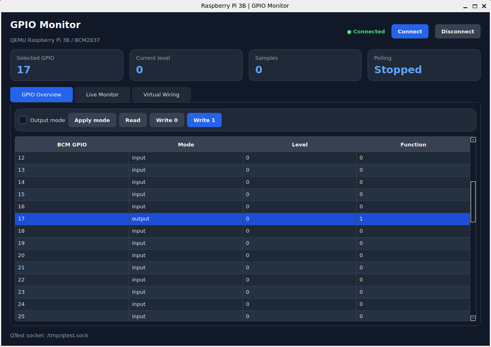
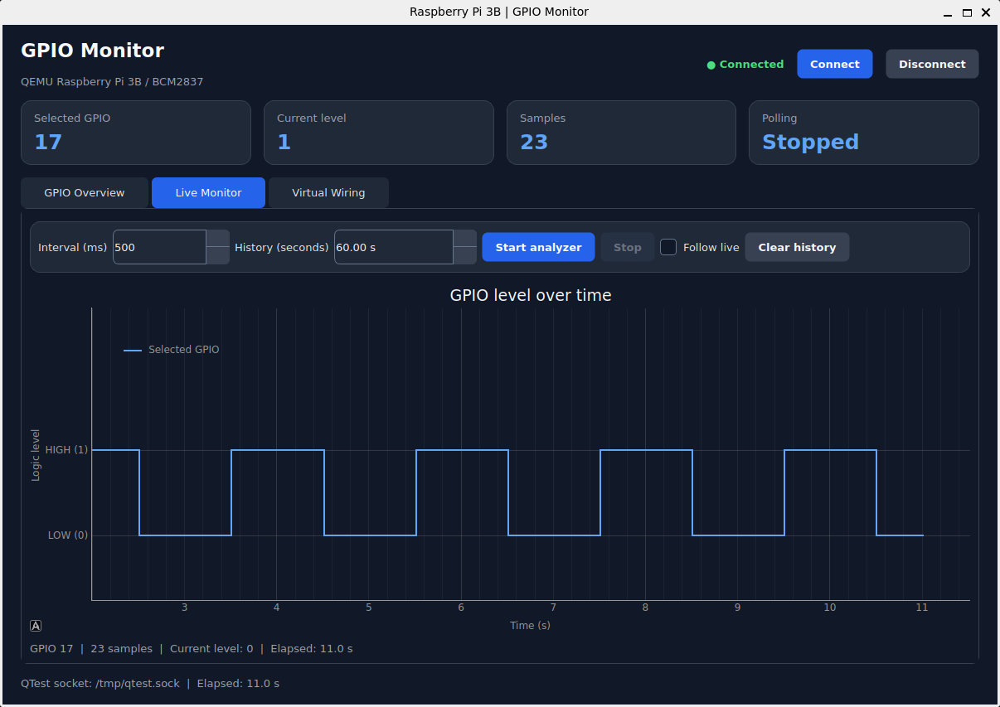
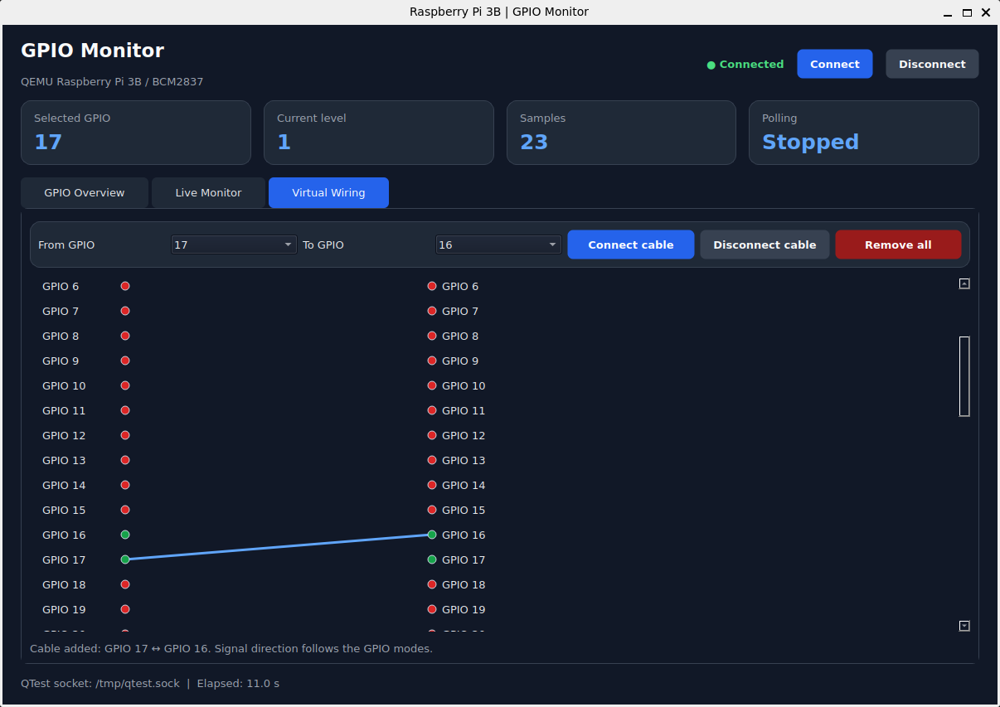

# QEMU Pi GPIO

A Qt-based GPIO monitor and virtual wiring tool for the emulated Raspberry Pi 3 Model B (`raspi3b`) in QEMU.

The application communicates with QEMU through the QTest Unix socket protocol and accesses the BCM2837 GPIO controller registers. It provides a graphical GPIO overview, manual pin control, a live logic-level analyzer, and software-based virtual cables between GPIO pins.

## Features

- **GPIO overview:** inspect GPIO indices `0–53`, their configured modes, logic levels, and function-select values.
- **GPIO control:** configure supported pins as inputs or outputs and write logic levels `0` and `1`.
- **Live analyzer:** collect GPIO snapshots and plot the selected pin's logic level over time.
- **Configurable sampling:** choose an analyzer interval from 50 ms to 60,000 ms.
- **Adjustable history window:** display between 5 seconds and 60 minutes of recorded data.
- **Virtual wiring:** connect two GPIO pins through the GUI without physical hardware.
- **Automatic level propagation:** attempt to propagate an output's logic level to a connected input.
- **Background processing:** perform QTest and GPIO operations in a dedicated Qt worker thread.
- **Dark-themed interface:** monitor GPIO states, control pins, and visualize virtual connections.
- **Automated tests:** test GPIO register operations and QTest client behavior.

## Screenshots





## Requirements

The project is designed for a Linux host running QEMU with Raspberry Pi 3B machine support.

### Software requirements

- Python 3.10 or newer.
- QEMU with `qemu-system-aarch64` and the `raspi3b` machine.
- `qemu-img`.
- Device Tree Compiler utilities, including `fdtoverlay`.
- Linux utilities: `losetup`, `blkid`, `mount`, and `umount`.
- `sudo` privileges for preparing the Raspberry Pi OS disk image.

On Debian- or Ubuntu-based distributions, install the dependencies with:

```bash
sudo apt update
sudo apt install \
    python3 \
    python3-venv \
    python3-pip \
    qemu-system-arm \
    qemu-utils \
    device-tree-compiler \
    util-linux \
    mount
```

Check whether your QEMU installation supports the required machine:

```bash
qemu-system-aarch64 -machine help | grep raspi3b
```

The command should list `raspi3b`. If it does not, install a compatible QEMU build.

> **Platform note:** The provided shell scripts target Linux. Running the Python GUI on other platforms may require a separate QEMU setup and an alternative way to provide the QTest Unix socket.

## Project Structure

```text
qemu-pi-gpio/
├── .gitignore
├── LICENSE
├── pyproject.toml
├── README.md
├── run-rpi.sh
├── setup-rpi.sh
├── src/
│   └── qemu_pi_gpio/
│       ├── __init__.py
│       ├── gpio.py
│       ├── gui.py
│       └── qtest.py
└── tests/
    ├── test_gpio.py
    └── test_qtest.py
```

Generated files such as `kernel8.img`, `bcm2710-rpi-3-b-nobt.dtb`, virtual environments, Python bytecode, and packaging artifacts are not required in the source repository.

### Main modules

| File | Responsibility |
|---|---|
| `src/qemu_pi_gpio/gui.py` | PySide6 GUI, GPIO table, live analyzer, virtual wiring visualization, and background worker. |
| `src/qemu_pi_gpio/gpio.py` | BCM2837 GPIO register access and pin-state handling. |
| `src/qemu_pi_gpio/qtest.py` | Synchronous QTest client communicating over a Unix domain socket. |
| `tests/test_gpio.py` | Tests for GPIO functionality. |
| `tests/test_qtest.py` | Tests for QTest client functionality. |
| `setup-rpi.sh` | Prepares the Raspberry Pi OS disk image and extracts boot files. |
| `run-rpi.sh` | Starts the emulated Raspberry Pi 3B in QEMU. |
| `pyproject.toml` | Python package metadata, dependencies, and CLI entry point. |

## Installation

Clone the repository and enter the project directory:

```bash
git clone https://github.com/atrepalin/QemuPiGPIO
cd qemu-pi-gpio
```

### 1. Create a virtual environment

```bash
python3 -m venv .venv
source .venv/bin/activate
```

On subsequent sessions, activate it again before running the application.

### 2. Install the package

Install the project in editable mode:

```bash
python -m pip install --upgrade pip
python -m pip install -e .
```

The dependencies declared in `pyproject.toml` are installed automatically:

- `PySide6==6.12.0`
- `pyqtgraph==0.14.0`

The project requires Python 3.10 or newer.

### 3. Verify the command

The package defines the following console entry point:

```bash
qemu-pi-gpio
```

It starts the GUI using the default QTest socket path, `/tmp/qtest.sock`.

You can also run the module directly:

```bash
python -m qemu_pi_gpio.gui
```

Both commands require the package to be installed in the active Python environment.

## Preparing the Raspberry Pi OS Image

The project uses an existing Raspberry Pi OS disk image. The setup script prepares it for the QEMU `raspi3b` machine.

**Back up the original image before running the script.** The image is modified in place.

Run:

```bash
chmod +x setup-rpi.sh run-rpi.sh
./setup-rpi.sh ./raspios.img
```

Replace `./raspios.img` with the path to your Raspberry Pi OS image.

### What the setup script does

The script performs the following operations:

1. Checks that the image exists and resolves its absolute path.
2. Resizes the disk image to 4 GB using `qemu-img resize`.
3. Attaches the image to a Linux loop device with partition scanning enabled.
4. Expects the boot and root partitions to be available as partition 1 and partition 2.
5. Reads the root partition's `PARTUUID`.
6. Mounts the boot and root partitions.
7. Copies `kernel8.img` from the boot partition into the project directory.
8. Creates `bcm2710-rpi-3-b-nobt.dtb` by applying the `disable-bt.dtbo` device-tree overlay.
9. Sets the password hash of the existing `pi` account to the hash configured in the script.
10. Enables serial login through `ttyAMA0` and removes the `ttyAMA1` serial-login link.
11. Synchronizes filesystem changes and cleans up the mounts and loop device.

The script prints the root `PARTUUID` and the generated artifact paths when preparation completes.

### Required boot files

The boot partition must contain:

```text
kernel8.img
bcm2710-rpi-3-b.dtb
overlays/disable-bt.dtbo
```

The image must also have the expected boot and root partition layout and contain an existing `pi` user.

Images with different partition layouts or missing boot files may require manual preparation.

### Guest credentials

The setup script installs a predefined password hash for the `pi` user. The intended password is:

```text
1234
```

This is a deliberately configured guest password, not a randomly generated password.

**Security warning:** `1234` is weak and must only be used for a disposable, isolated development image. Change it before using the guest in any environment where unauthorized access matters. Do not reuse it for other accounts or systems.

The password hash is embedded in `setup-rpi.sh`. Anyone who can inspect the script can see the hash, and the intended password is documented here.

The setup script does not create the `pi` account. It exits with an error if the account does not exist in the image's `/etc/shadow`.

## Starting QEMU

Once image preparation is complete, start QEMU using the root partition's `PARTUUID` printed by the setup script.

```bash
./run-rpi.sh ./raspios.img YOUR_ROOT_PARTUUID
```

Replace `YOUR_ROOT_PARTUUID` with the actual value from your image.

For example, the command format is:

```bash
./run-rpi.sh ./raspios.img 12345678-02
```

The PARTUUID above is only an example. Do not copy it unless it matches your image.

### QEMU configuration

The launch script configures QEMU with the following settings:

| Parameter | Configuration |
|---|---|
| Machine | `raspi3b` |
| Architecture | AArch64 |
| Memory | 1 GB |
| Kernel | `kernel8.img` |
| Device tree | `bcm2710-rpi-3-b-nobt.dtb` |
| Disk image | Supplied Raspberry Pi OS image |
| Root filesystem | Identified by `PARTUUID` |
| Root filesystem type | `ext4` |
| Serial console | `ttyAMA0` |
| Display | Disabled |
| Monitor | Disabled |
| Networking | User-mode networking with a USB network device |
| QTest socket | `/tmp/qtest.sock` |

The guest's serial console is connected to the terminal running `run-rpi.sh`.

Keep this terminal open while using the GUI.

The launch script removes an existing `/tmp/qtest.sock` and starts QEMU with a Unix QTest socket configured as a server with `wait=off`.

## Launching the GUI

Start QEMU first and wait for it to initialize. Then open a second terminal, activate the Python virtual environment, and run:

```bash
qemu-pi-gpio
```

The application uses `/tmp/qtest.sock` by default.

You can specify a different socket path:

```bash
qemu-pi-gpio --socket /path/to/qtest.sock
```

The socket path supplied to the GUI must match the path configured in QEMU.

### Recommended startup sequence

1. Install the project with `python -m pip install -e .`.
2. Prepare the image with `./setup-rpi.sh`.
3. Start QEMU with `./run-rpi.sh`.
4. Wait for QEMU to initialize.
5. Launch `qemu-pi-gpio` in another terminal.
6. Click **Connect** in the GUI.
7. Select a GPIO row and test its mode and logic level.
8. Optionally connect two pins in the Virtual Wiring tab.
9. Start the analyzer to record GPIO snapshots.

The GUI does not launch QEMU automatically. QEMU must remain running for GPIO access to work.

## Using the Application

### GPIO Overview

The overview displays the state of GPIO indices `0–53`.

Each row includes:

- **BCM GPIO:** GPIO controller index.
- **Mode:** input, output, or an alternate-function code.
- **Level:** the current level returned by the GPIO level register.
- **Function:** the numeric function-select value.

Select a row to choose the GPIO pin for manual control.

| Control | Behavior |
|---|---|
| Connect | Opens the QTest connection. |
| Disconnect | Closes the connection. |
| Output mode | Selects output mode when enabled and input mode when disabled. |
| Apply mode | Applies the selected mode to the selected GPIO. |
| Read | Requests a fresh GPIO snapshot. |
| Write 0 | Writes a LOW value to the selected GPIO. |
| Write 1 | Writes a HIGH value to the selected GPIO. |

GPIO mode changes are applied through the BCM2837 function-select registers.

Writing a level uses the GPIO set or clear register, depending on the requested value.

### Live Monitor

The live analyzer periodically records GPIO snapshots and plots the selected pin's logic level over elapsed monotonic time.

Available controls:

- **Interval (ms):** 50–60,000 ms.
- **History (seconds):** 5–3,600 seconds.
- **Start analyzer:** begins collecting snapshots.
- **Stop:** stops analyzer sampling.
- **Follow live:** automatically adjusts the plot to the latest time window.
- **Clear history:** clears recorded history and resets the sample counter.

The analyzer stores valid binary levels for all GPIO pins during each recorded snapshot. The graph displays only the currently selected GPIO.

The sample counter measures snapshots, not individual pin readings or electrical transitions.

### Virtual Wiring

Virtual cables connect two distinct GPIO indices.

To add a cable:

1. Open the **Virtual Wiring** tab.
2. Select the first pin using **From GPIO**.
3. Select the second pin using **To GPIO**.
4. Click **Connect cable**.
5. Configure one endpoint as an output and the other as an input.
6. Observe the resulting states in the overview.

The direction of propagation is determined from the current GPIO modes, not from the order in which the endpoints were selected.

The worker checks connections every 50 ms. For a valid output-input pair, it attempts to write the output's level to the input endpoint when their reported levels differ.

Cables are inactive when both endpoints are inputs, both are outputs, or either endpoint is in an unsupported mode.

The wiring diagram is a visualization of these software connections. It is not a physical or electrical circuit simulation.

## Technical Details

### BCM2837 GPIO register access

The driver in `src/qemu_pi_gpio/gpio.py` uses the GPIO peripheral base address:

```text
0x3F200000
```

It accesses the following registers:

| Register | Offset | Purpose |
|---|---:|---|
| `GPFSEL0`–`GPFSEL5` | `0x00`–`0x14` | GPIO function selection. |
| `GPSET0`–`GPSET1` | `0x1C`–`0x20` | Set output levels HIGH. |
| `GPCLR0`–`GPCLR1` | `0x28`–`0x2C` | Set output levels LOW. |
| `GPLEV0`–`GPLEV1` | `0x34`–`0x38` | Read GPIO levels. |

Each GPIO function-select field occupies three bits.

The driver interprets function code `0` as input and function code `1` as output. Other function codes are reported as `altN`.

The supported index range is `0–53`, representing 54 GPIO controller indices. This is not a mapping to physical header pin numbers.

### QTest communication

The client in `src/qemu_pi_gpio/qtest.py` implements a synchronous QTest protocol client over a Unix domain socket.

It supports:

- Connecting to the QTest socket.
- Sending line-oriented commands.
- Reading 32-bit memory-mapped registers using `readl`.
- Writing 32-bit memory-mapped registers using `writel`.
- Handling unexpected responses, socket errors, and QEMU-reported failures.

The client serializes commands using a lock. GPIO operations are synchronous, and each register access requires communication with QEMU.

### Background worker

The `GPIOWorker` class in `gui.py` runs in a dedicated Qt thread.

It uses separate timers for:

- GUI snapshot refreshes, nominally every 200 ms.
- Analyzer sampling, configurable by the user.
- Virtual wiring propagation, nominally every 50 ms.

These intervals are timer settings, not guaranteed execution rates. Actual timing depends on QEMU response latency and the amount of work performed by each callback.

## Running Tests

The repository includes:

```text
tests/
├── test_gpio.py
└── test_qtest.py
```

Run the test suite from the project root with:

```bash
python -m unittest discover -s tests -v
```

If the tests use `pytest` fixtures or conventions instead of `unittest`, install pytest and run:

```bash
python -m pip install pytest
python -m pytest -v
```

The second command is an alternative for a pytest-based test suite. Use the test runner appropriate to the actual test implementation.

The tests can be extended to cover GPIO mode validation, register addressing, QTest response parsing, socket failures, and virtual wiring behavior.

## Limitations

This project is a software development and educational tool. Its output must be interpreted in the context of QEMU's emulation model and the implementation's sampling and propagation mechanisms.

### QEMU hardware coverage

- Behavior depends on the selected QEMU version and its `raspi3b` machine implementation.
- Not every Raspberry Pi peripheral is fully emulated.
- A successful QTest connection does not guarantee that the guest has booted successfully or that every register behaves as expected.
- Behavior observed in QEMU may differ from behavior on a physical Raspberry Pi 3 Model B.

### Virtual wiring is not electrical simulation

- Connections are implemented in software, not through physical GPIO pins.
- The implementation does not simulate voltage, current, resistance, capacitance, pull-up/down resistors, floating inputs, or electrical contention.
- It does not provide cycle-accurate signal propagation.
- The 50 ms propagation timer can delay or miss short-lived changes.
- The application does not generate physical GPIO interrupts or reproduce all hardware interrupt behavior.

**Input-level propagation is QEMU-dependent.** The current implementation writes to `GPSET` or `GPCLR` even when the target pin is configured as an input. Whether the emulated GPIO model reflects that write in the level returned by `GPLEV` depends on the QEMU implementation. This behavior should be validated against the QEMU version in use.

### GPIO mode and register limitations

- The GPIO driver does not currently enforce output mode before a write. Writing to an input or alternate-function pin may have no useful effect.
- Alternate functions are shown as numeric codes (`altN`), not decoded peripheral names.
- The application does not implement dedicated UART, SPI, I²C, PWM, or other peripheral analyzers.
- GPIO controller indices are not physical header pin numbers.
- Not all indices necessarily correspond to externally accessible pins.

### Analyzer limitations

- The analyzer samples states periodically; it does not record every edge.
- The minimum configured interval is 50 ms, nominally 20 sampling intervals per second.
- Actual sample rates can be lower because a snapshot involves multiple synchronous QTest commands.
- Short pulses and fast transitions can be missed.
- The graph is not suitable for high-frequency digital signals, accurate pulse-width measurements, protocol decoding, or timing-critical tests.
- Snapshot values are read sequentially rather than atomically, so individual pins may represent slightly different instants in time.

### History limitations

- History is held in memory and is not saved automatically.
- Each GPIO has a bounded history of up to 30,000 samples.
- The selected history window determines the displayed time range, not the storage capacity.
- At high sample rates, the retained history may cover less time than the selected window.
- Starting the analyzer clears the selected GPIO's history, while histories for other GPIOs may remain in memory.
- Clearing history resets the sample counter and elapsed-time reference.

### Performance and concurrency

- The GUI, analyzer, and virtual wiring share a single QTest client.
- QTest commands are serialized, so intensive sampling and wiring can delay other GPIO operations.
- Slow QEMU responses can reduce the effective update rate.
- The worker uses timer callbacks rather than a real-time scheduling mechanism.
- A blocked QTest command may delay worker shutdown until the operation returns or times out.

### Image preparation and operating environment

- `setup-rpi.sh` modifies the disk image in place and resizes it to 4 GB.
- The script assumes a compatible two-partition image and particular boot files.
- The script requires elevated privileges for loop-device management and filesystem mounts.
- The supplied shell scripts target Linux and are not portable unchanged to Windows.
- The fixed QTest socket path `/tmp/qtest.sock` can conflict with another QEMU instance.
- The GUI does not start or supervise QEMU automatically.

### Security

- QTest provides low-level access to the emulated machine. Keep the socket local and accessible only to trusted users.
- The setup script embeds a known password hash for the guest's `pi` account. The intended password is `1234`.
- This password is weak and intended only for disposable test environments. Change it before using the image in a less-trusted environment.
- Review scripts before running them with elevated privileges.
- Use a backup of the disk image if the original must remain unchanged.

## Troubleshooting

### The GUI cannot connect

Confirm that QEMU is running and that the socket exists:

```bash
test -S /tmp/qtest.sock && echo "QTest socket exists"
```

Check the socket path passed to the GUI and the path configured in `run-rpi.sh`.

If the socket does not exist, inspect QEMU's startup output and confirm that the process started successfully.

### The guest does not boot

Check that:

- The image contains the expected boot and root partitions.
- The supplied `PARTUUID` matches the root partition.
- `kernel8.img` and `bcm2710-rpi-3-b-nobt.dtb` exist in the project directory.
- The image contains the required overlay and boot files.
- The serial console does not report kernel or root filesystem errors.

### Virtual wiring does not propagate a level

Confirm that exactly one endpoint is an output and the other is an input.

If the modes are correct, test whether the selected QEMU version reflects GPIO set/clear writes to an input in the `GPLEV` registers. The virtual wiring implementation depends on this behavior.

### The analyzer shows no samples

Connect to QEMU and start the analyzer. Confirm that the selected pin returns valid binary levels and that samples fall within the selected history window.

### Sampling is slower than expected

Increase the sampling interval and reduce simultaneous activity. Each GPIO snapshot requires multiple synchronous QTest commands, and the wiring timer also accesses GPIO registers.

## Development and Future Improvements

Potential improvements include:

- Automated integration tests against a running QEMU instance.
- GPIO physical-header pin mapping.
- Alternate-function decoding.
- Analyzer history export to CSV.
- Edge-triggered recording and event markers.
- Improved reconnect and timeout handling.
- Configurable QTest socket paths in both shell scripts.
- More realistic emulated input behavior for virtual wiring.
- Configurable virtual cable propagation intervals.
- GUI tests for connection state and control behavior.

## License

This project is licensed under the MIT License. See [LICENSE](LICENSE) for the full license text.

## Disclaimer

QEMU Pi GPIO is intended for experimentation, debugging, education, and software-level testing. It does not guarantee cycle-accurate hardware emulation, electrical equivalence to physical GPIO connections, or compatibility with every QEMU and Raspberry Pi OS version.

Validate hardware-dependent behavior on the intended target platform before relying on it.
